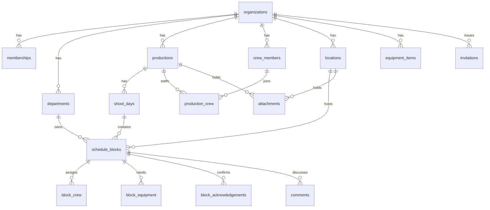

# Data model

Every table that holds organisation data carries `organization_id`. Child tables reference their parent with a composite key that includes it, so the database itself refuses a record that points at another organisation's data, independent of row level security.

## Notes

- `memberships` ties a user to an organisation with one role. A department lead must have a department; every other role must not. An organisation cannot lose its last owner.
- A crew member is a person on the crew list. They may or may not have an account (`user_id`). Crew accounts see productions through `production_crew`.
- `schedule_blocks.version` increases on every update. The interface sends the version it last saw, which is how a concurrent edit is detected.
- Soft deletion uses `deleted_at`. Archived productions, shoot days, locations and crew members are hidden from everyone except owners and producers. Blocks and attachments stay visible to whoever may edit them (see ADR 0004).
- `profiles` is filled by a trigger when an account is created. `create_organization()` is the only way to create an organisation, because it also creates the owner membership in the same step.

Not modelled yet: notifications, activity events, bookmarks and saved views. They arrive with the features that use them, each with its own row level security and tests.
